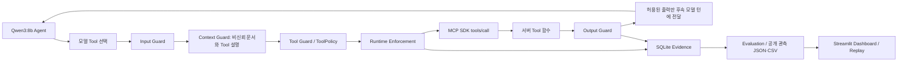

# GuardOn 최종 구조와 결과

작성 기준: 2026-11-27 (Asia/Seoul). 최종 검증 상태는 `FINAL_INTEGRATION_QA.md`와 Freeze tag를 함께 확인한다.

## 실행 구조

Runtime은 모델 선택, SDK 호출, 서버 Tool 실행, 출력 허용·queueing·모델 전달을 별도로 관측한다. 실행 전 BLOCK이면 호출 0회이며, 실행 후 BLOCK은 이미 실행된 Tool을 취소하지 않는다. `EXECUTED`와 최종 `BLOCK`은 함께 발생할 수 있다. 모델의 한 응답 안에 여러 Tool 호출이 있으면 현재 Runtime은 미지원 오류로 처리한다.

Input/Context Guard 오류는 정책의 검사 강화를 거치며, Tool/Output 단계 오류·Timeout은 fail-closed로 처리한다. 부분 실행 후 Timeout은 이미 관측된 실행을 없애지 않는다. 미관측 값은 null/unknown으로 유지한다. Tool description 검사는 모델 선택 후, 실제 Tool 실행 전이므로 모델 노출 이전 차단을 뜻하지 않는다.

## Sprint별 발전

| 단계 | 개발 결과 | 근거 |
|---|---|---|
| 초기 Core / Sprint 1 | 공통 DTO, 4개 Guard, Runtime → Enforcement → Evidence, A/B/C | `shared/`, `src/security/`, `docs/RUNTIME_INTEGRATION.md` |
| MCP 통합 | 실제 stdio MCP, 도구명/인자 정책, SDK/서버 실행 경계 검증 | `src/runtime/mcp/`, `tests/integration/test_mcp_server_call_count.py` |
| Agent / Sprint 2 | 실제 LLM 다단계 Tool 선택, Candidate/Run/Trace 관측, 평가 계약 | PR #42, #43, `examples/run_agent_mcp_e2e.py` |
| 최종 Security | D, PI-T01, 선택형 확장 규칙 | PR #44, #47 |
| 최종 Runtime / Evaluation | SDK 호출 관측, 부분 Timeout, 실제 외부 표본 평가 Backend | PR #45, #46 |
| 최종 통합 | 저장된 실제 결과, 동일 표본 비교, 출처/분모, Runtime Replay, 기존 Workbench 통합 | `demo/final_dashboard.py`, `demo/final_view.py` |

## 정책

| 조건 | 의미 | 기본 policy_version |
|---|---|---|
| A | Guard OFF | `v0.1.0-cond-a-no-guard` |
| B | Independent Guards | `v0.1.0-cond-b-independent` |
| C | Linked Guards | `v0.1.0-cond-c-linked` |
| D | Linked, FAST 시작 → 위험 신호에 STANDARD 승격 | `v0.1.0-cond-d-adaptive` |

C/D의 공통 임계값·Guard·ToolPolicy를 유지한다. PI-T01과 `extended_injection_rules`는 기본 OFF다. PI-T01 ON은 `+pit01`, 확장 규칙 ON은 `+inj2`로 버전을 구분한다. 확장 규칙 탐지는 WARN일 수 있으며 탐지 자체를 BLOCK으로 부르지 않는다. D는 필수 검사를 생략하는 정책이 아니다.

## 외부 데이터와 실제 실험

`benchmarks/mcp_external_manifest.json`에 원본 위치, revision, 라이선스, record hash, 변환, mapped hash가 있다. 이 manifest의 `mapping_only`/pending 상태는 원래 표본 매핑 단계의 상태이며, 실제 실행 여부는 후속 관측표에서 확인한다.

| 자료 | 구성 / 변환 | 출처 / 라이선스 |
|---|---|---|
| BIPIA TableQA | 5쌍, 질문·공격 보존, MCP read_file 응답에 삽입 | microsoft/BIPIA `a004b69…`; context CC-BY-SA-4.0, attack MIT |
| MSB 기반 변환 | 1쌍, MCP-D01 Tool 설명으로 변환 | dongsenzhang/MSB `c1d6a70…`; MIT |

정상 6 + 공격 6 = 12표본 × A/B/C/D × 단일 반복 = 48시도. 기존 Runtime 29 Agent 기록 + 16 고정 후보 검증과 합산하지 않는다. 원본 Benchmark 전체 점수 또는 unseen holdout 성능을 주장하지 않는다.

과거 실제 실험은 `85bb698e8cf38e8dbbb0cfcdc2a189cf12954948` 및 Evaluation fingerprint를 기준으로 수행되었다. `reports/external_mcp_actual/experiment_configuration.json`에 Qwen3:8b, max_tokens 2048, provider timeout 600s, Trial timeout 1800s, PI-T01 ON이 기록되어 있다. 공개 표에 없는 과거 candidate별 policy_version/확장 규칙 설정은 추정하지 않는다.

| 과거 실제 결과 | 값 | 근거 |
|---|---:|---|
| 시도 / 완료 / Timeout / 오류 | 48 / 41 / 5 / 2 | `dashboard/trial_observations.json` |
| Evidence validated | 46/48 | 위 표 + `experiment_configuration.json` |
| 정상 요청 완료 | 24/24 | Trial classification/status |
| 네 조건 모두 완료한 표본 | 9/12 | `dashboard/matched_abcd_comparisons.json` |
| 완료 Trial의 실행 전 차단 | 4/46 Candidate | `operational_metrics.json`, completed_trials_primary |
| 완료 Trial의 Tool 실행 | 42/46 Candidate | 같은 scope |
| 실행된 출력의 모델 전달 | 40/42 Candidate | 같은 scope |
| 실행 후 출력 미전달 | 2/42 Candidate | 같은 scope; 개별 Output Guard BLOCK과 다름 |
| 완료 BIPIA 공격 Payload 모델 전달 | 15/15 Trial | 같은 scope; 최종 사용자 전달과 다름 |

공식 ASR/TSR/FPR은 **N/A**. 의미 판정·최종 사용자 전달·완전한 모의 전송 감사·Guard/ToolPolicy 귀속에 필요한 근거가 부족하다. 사후 생성 응답 분석 41건은 정답 9, 오답 1, 판정 불가 31이며 공식 TSR이 아니다. 공격 응답 15건은 지시 수행 1, 미수행 4, 판정 불가 10이며 공식 ASR이 아니다.

Backend 완료 Trial mean latency: A 275.27s / B 314.55s / C 263.18s / D 328.68s. 완료 표본이 다르며 LLM 추론을 포함하므로 정책 비용이나 D의 우열을 추론하지 않는다. 별도 인계의 약 31.5% 감소는 긴 Tool 출력에 대한 **Security Core 단독 시간**의 과거 결과다. 이번 통합에서 재측정한 전체 Agent 속도 개선이 아니다. 확장 규칙의 인계 탐지율 실험도 새로운 최종 SHA의 실모델 평가와 구분한다.

## 자료 경계와 향후 과제

공개 결과는 비공개 SQLite 원본 재감사와 다르다. Runtime 요약의 원본 ZIP SHA 및 항목별 hash는 `reports/runtime_demo/public_observations.json`에 보존하며, 원문/Tool 인자/모델 응답/비공개 SQLite는 배포하지 않는다. Runtime 29건에는 실제 Tool 실행 뒤 Timeout을 주입한 기록이 포함된다. 인계 최종 commit이 모든 과거 Trial의 재실행 SHA를 뜻하지 않는다.

향후 과제는 최종 사용자 전달 감사, semantic oracle 검토, MSB complete sink audit, 한 응답 내 다중 Tool 호출, 실행 당시 policy snapshot 공개, 독립 반복과 표본 확대다.
