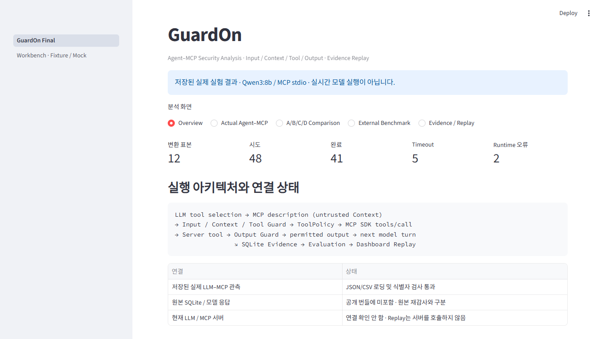
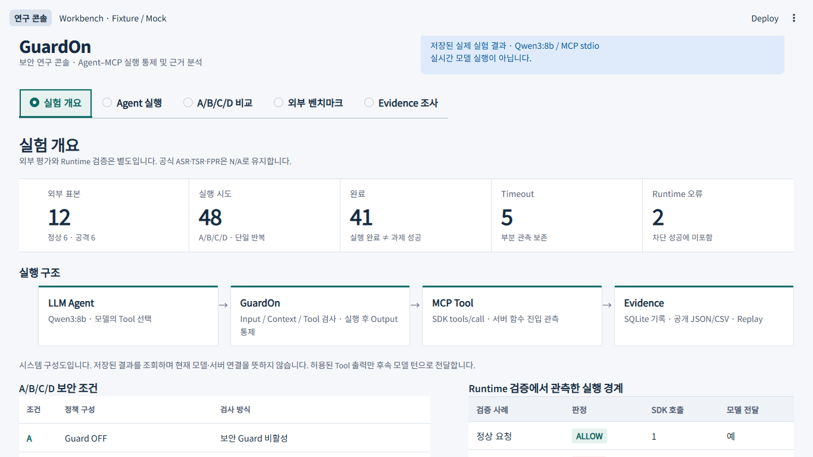

# GuardOn Dashboard Before / After

실제 Streamlit 화면을 Chrome headless에서 캡처했다. Before는 Freeze `4a569752a905666c1b52229edb52825b7a01b579`, After는 Freeze 이후 UI 리디자인 브랜치다. 데이터·정책·실험 수치는 동일하다. 캡처를 목업으로 생성하거나 합성하지 않았다.

| 화면 | Before 1366×768 | After 1366×768 | Before 1920×1080 | After 1920×1080 |
|---|---|---|---|---|
| Overview | [화면](before/overview-1366x768.png) | [화면](after/overview-1366x768.png) | [화면](before/overview-1920x1080.png) | [화면](after/overview-1920x1080.png) |
| Agent 실행 | [화면](before/agent-1366x768.png) | [화면](after/agent-1366x768.png) | [화면](before/agent-1920x1080.png) | [화면](after/agent-1920x1080.png) |
| A/B/C/D 비교 | [화면](before/comparison-1366x768.png) | [화면](after/comparison-1366x768.png) | [화면](before/comparison-1920x1080.png) | [화면](after/comparison-1920x1080.png) |
| 외부 벤치마크 | [화면](before/benchmark-1366x768.png) | [화면](after/benchmark-1366x768.png) | [화면](before/benchmark-1920x1080.png) | [화면](after/benchmark-1920x1080.png) |
| Evidence 조사 | [화면](before/evidence-1366x768.png) | [화면](after/evidence-1366x768.png) | [화면](before/evidence-1920x1080.png) | [화면](after/evidence-1920x1080.png) |

추가 캡처: [실행 전 BLOCK](after/pre-block-1366x768.png), [실행 후 통제](after/post-block-1366x768.png), [Latency 탭](after/latency-1366x768.png), [390px 화면](after/overview-390x844.png).

## Overview 비교

| Before | After |
|---|---|
|  |  |

검사 결과: [browser-qa.json](after/browser-qa.json). 캡처는 지정 viewport의 보이는 영역이며 긴 페이지 전체를 한 화면에 축소하지 않았다. 페이지 스크롤은 정상적으로 유지한다.
